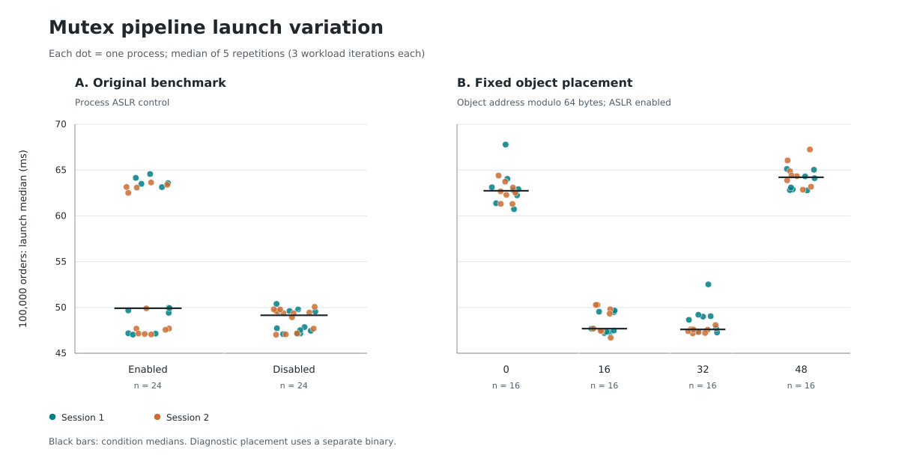

# What selects the mutex pipeline's launch-time performance level

An **offset** below means the engine object's address modulo 64: its byte
position inside a cache line. A **launch score** is the median wall time of
five repetitions. **Spread** is `(largest / smallest - 1) × 100%`; **CV** is
sample standard deviation divided by the mean of launch scores. A **block**
launches each diagnostic condition once, rotating their order. It is distinct
from the four-program round in [BENCHMARKING.md](BENCHMARKING.md).

This investigation uses the 2026-10-12 repeated-launch study and new October 14
measurements on the same machine. The archived single-launch recordings are
not inputs. All scores in the following tables come from the new measurements.

## Results: 100,000-order mutex pipeline

| Executable and condition | Launches | Median | Minimum–maximum | Spread | Launch CV |
|---|---:|---:|---:|---:|---:|
| Original, ASLR enabled | 24 | 49.91 ms | 47.03–64.56 ms | 37.27% | 14.24% |
| Original, ASLR disabled for this process | 24 | 49.14 ms | 47.03–50.38 ms | 7.14% | 2.48% |
| Placement diagnostic, offset 0 | 16 | 62.74 ms | 60.73–67.78 ms | 11.62% | 2.64% |
| Placement diagnostic, offset 16 | 16 | 47.69 ms | 46.70–50.28 ms | 7.69% | 2.64% |
| Placement diagnostic, offset 32 | 16 | 47.60 ms | 47.17–52.51 ms | 11.34% | 2.82% |
| Placement diagnostic, offset 48 | 16 | 64.21 ms | 62.78–67.24 ms | 7.11% | 1.99% |

ASLR means address space layout randomization. It stays enabled in all four
placement conditions. Their 16 launches each have 16 different absolute object
addresses and 12–15 different offsets within a 4 KiB page; only the address
modulo 64 is fixed. Every launch logs the same object address across its three
sizes and five repetitions.



The original executable produced 14 fast and 10 slow launches with ASLR enabled;
all 24 process-local ASLR-disabled launches were fast. Fixing offsets 0/48
selected the slow level in all 32 launches, and offsets 16/32 selected the fast
level in all 32 launches. The three workload sizes agreed at the launch-median
level in all 112 launches. All 560 individual 100,000-order repetitions agreed;
some smaller-workload repetitions crossed the gap, so this is not a claim that
every individual repetition at every size stayed in its launch's band.

**The mutex pipeline's two levels are selected by the stack object's position
within a cache line.** Fixing that position removes the switching between
levels and substantially reduces variation. This is a reproducibility finding,
not an engine speedup. The remaining variation and the other two-thread
benchmarks are not fully explained.

## Independent checks

GDB observed the first engine address in 16 launches of the unchanged native
binary, with ASLR enabled, and detached before the constructor or timed loop
ran. All 9 observations at offsets 0/48 were slow; all 7 at offsets 16/32 were
fast. Only the completed target benchmark JSON and address observation are used
from this study. Launcher exit status and process CPU, switch, fault and derived
interference telemetry describe GDB and must not be interpreted as the target.

A second experiment crossed offsets 0 and 16 with both fixed worker directions
and an unpinned control, with the same interposer loaded in all conditions.
There were 12 launches per cell; the table shows their 100,000-order medians.

| Worker placement | Offset 0 | Offset 16 |
|---|---:|---:|
| Scheduler chooses within CPUs 1 and 3 | 63.55 ms | 47.37 ms |
| Consumer on CPU 1, producer on CPU 3 | 62.83 ms | 48.03 ms |
| Consumer on CPU 3, producer on CPU 1 | 63.27 ms | 48.58 ms |

All 36 offset-0 launches stayed slow (60.03–65.98 ms), and all 36 offset-16
launches stayed fast (46.47–51.04 ms). Swapping worker roles or preventing their
migration does not remove the split. Worker placement is therefore not a
necessary cause of this split on this core pair. The initial thread still has
the two-core mask; smaller scheduling effects remain possible.

## What changes at the cache-line boundary

The native binary places the engine at `%rsp + 0x70` in the throughput function.
The object's size is 216 bytes and alignment is 8. In this build, the deque's
start current-position pointer is at object byte 16, its finish current-position
pointer at byte 48, the mutex lock word at byte 80, the condition variable at
120, the completion flag at 168, and the latency recorder at 192. These are
build-specific observations, not portable C++ layout guarantees.

| Object offset | Start pointer's line | Finish pointer's line | Mutex lock's line |
|---:|---:|---:|---:|
| 0 | 0 | 0 | 1 |
| 16 | 0 | 1 | 1 |
| 32 | 0 | 1 | 1 |
| 48 | 1 | 1 | 2 |

Line numbers are relative to the cache line containing the object's first byte.
Offsets 16/32 put the finish pointer and lock on the same line. Offsets 0/48 put
the two queue position pointers together and the lock on the next line. Other
fields also change their sharing relationships. Recreating the worker threads
does not change this main-stack location, which explains why repeated thread
creation did not make the launch alternate between levels.

Hardware profiling used offsets 0 and 16, fixed consumer CPU 1 / producer CPU 3,
and eight launches each. These are medians of **whole-launch** counters: startup,
allocation, thread creation, and 2.4 million workload orders across all three
sizes. They are not counters for an isolated 100,000-order iteration.

| Hardware event | Offset 0 | Offset 16 |
|---|---:|---:|
| Core cycles | 6.490 billion | 4.961 billion |
| Instructions | 7.460 billion | 6.729 billion |
| Forwarded snoop-hit loads (`xsnp_fwd`) | 7.173 million | 3.442 million |
| L2 requests for ownership (`all_rfo`) | 20.193 million | 15.002 million |
| Page faults | 87,065.5 | 87,027.5 |

The forwarded-load event includes both modified and clean forwarded lines; it
is not a pure modified-line counter. The roughly 2.08× forwarded-load count and
1.35× ownership-request count support a cache-coherence explanation. Moving the
whole object does not isolate one member, so the data do not establish which
field or a specific false-sharing mechanism accounts for all the extra time.
All 11 collected events reported 100% running time; branches, misses, switches,
migrations and complete counts are in the [profiling report][perf-report].

## Other two-thread benchmarks

A smaller screen used eight launches per condition, five repetitions each,
and the original executables. These are 100,000-element/order launch ranges.

| Benchmark | ASLR enabled | ASLR disabled for the process |
|---|---:|---:|
| SPSC producer/consumer queue | 3.56–7.00 ms | 5.51–8.67 ms |
| Mutex producer/consumer queue | 25.05–37.21 ms | 24.00–45.72 ms |
| SPSC matching pipeline | 26.96–29.51 ms | 27.10–29.00 ms |

Disabling ASLR did not make the queue benchmarks reproducible. It reduced the
SPSC queue's launch CV from 27.24% to 12.94%, but its remaining spread was 57.18%;
the mutex queue's spread increased from 48.51% to 90.51%. These exploratory
samples do not support a general ASLR-only solution. Per-role placement,
allocator behavior and other address relationships remain candidates there.

## Environment, validity and limits

- Source commit: `6111ae47b5bb7a13e0353deb4950578b1d64ee8f`. The production
  sources, benchmarks and CMake configuration are identical to `e8870ee`.
  The native mutex executable also has the same SHA-256 as the October 12
  study: `c8390007528be684db3d85cae9bf827f9ee885f2b8d81be4803feb8c4e922ea0`.
  Diagnostic tooling was uncommitted during recording; exact source hashes,
  matching recorder snapshots and generated diagnostic source/build commands
  are preserved with the evidence.
- CPU: Intel Core i5-1135G7; kernel `7.0.0-34-generic`; GCC
  `15.2.0-16ubuntu1`; Release `-O2 -DNDEBUG -std=c++20`; Google Benchmark 1.8.3.
  Each study records executable SHA-256 values and complete commands.
- Measurement cores: 3 and 1; housekeeping: 0 and 2. The installed setup selected
  the performance governor, disabled turbo, set min/max performance percentages
  to 100/100, offlined SMT siblings and moved device interrupts. Global ASLR
  remained 2 and THP remained `madvise`.
- All 248 scored launches had zero recorded thermal-throttle events, device
  interrupts on the measurement cores, and suspended seconds. No scored launch
  was removed. The initial cleared-mode attempt stopped before scoring because
  28 user tasks could not be moved; its failure and successful restoration are
  retained. The completed experiments use the shared condition.
- External CPU activity was measured, not eliminated. Maximum foreign CPU time
  was 29.40 ms/s in the native ASLR study, 61.73 ms/s in the four-offset study,
  and 95.48 ms/s in the worker-placement study. Residual scatter remains.
- The first four completed studies collected no per-launch frequency samples:
  output arrived before the recorder's one-second sampling timeout. They show
  the configured policy, not an observed constant 2400 MHz. The recorder was
  then changed to sample after 0.1 seconds of silence. All profiling launches
  had samples; maxima were 2400.000–2400.028 MHz, with lower readings when a
  core could be idle. These readings do not independently establish frequency
  throughout every timed region. The raw values are retained.
- Process CPU clocks and derived interference telemetry for spawning prefixes
  (`perf` and GDB) are not used: their accounting follows the wrapper. Per-CPU
  interrupt, throttle and frequency snapshots remain useful; hardware/software
  event counts come directly from perf.
- Physical page placement, THP, allocator arenas/thread caches, and remaining
  kernel activity were not individually controlled. They are not excluded as
  contributors to residual variation or as mechanisms interacting with layout.
  The result covers this build and boot, not other compilers or machines.

## Reproduce and inspect

Normal engine and benchmark builds remain unchanged. The placement generator
copies the original benchmark into a separate translation unit, replaces only
its local engine storage with an RAII placement wrapper, and logs addresses
before timing. The original class and timed `start()`/`stop()` loop are preserved
verbatim. All four offsets use the same diagnostic executable. Original three
iterations per repetition, order generation and saturated-queue semantics stay
in place. Latency outputs, when present, must be interpreted as TSC ticks.

```bash
cmake --build build/release -j4
ctest --test-dir build/release --output-on-failure
python3 scripts/diagnostics/build_mutex_layout.py
mkdir -p build/diagnostics
cc -std=c11 -O2 -Wall -Wextra -Werror -fPIC -shared \
  scripts/diagnostics/thread_affinity.c -o build/diagnostics/thread_affinity.so \
  -ldl -pthread
```

Each command below uses two sessions, five repetitions and the shared condition:

```bash
python3 scripts/bench_diagnose.py --matrix scripts/diagnostics/aslr_matrix.json \
  --output results/new-aslr --sessions 2 --blocks 12 --repetitions 5 --interference shared
python3 scripts/bench_diagnose.py --matrix scripts/diagnostics/layout_matrix.json \
  --output results/new-layout --sessions 2 --blocks 8 --repetitions 5 --interference shared
python3 scripts/bench_diagnose.py --matrix scripts/diagnostics/affinity_matrix.json \
  --output results/new-affinity --sessions 2 --blocks 6 --repetitions 5 --interference shared
python3 scripts/bench_diagnose.py --matrix scripts/diagnostics/native_layout_matrix.json \
  --output results/new-native-layout --sessions 2 --blocks 8 --repetitions 5 --interference shared
python3 scripts/bench_diagnose.py --matrix scripts/diagnostics/perf_matrix.json \
  --output results/new-perf --sessions 2 --blocks 4 --repetitions 5 --interference shared
python3 scripts/bench_diagnose.py --matrix scripts/diagnostics/other_dual_matrix.json \
  --output results/new-other-dual --sessions 2 --blocks 4 --repetitions 5 --interference shared
```

The recorder enters and restores measurement mode itself through the two
installed password-free sudo commands. The recorded command paths differ from
these examples; exact originals are in each raw `*.command.json`. Keep command
and environment lengths fixed within a condition. Even with ASLR disabled,
changing them can move the stack object and select the other band. Disabling
ASLR is therefore not a guarantee of the faster result. Simply applying
`alignas(64)` would select offset 0, the slower placement here.

`python3 scripts/diagnostics/summarize.py <study>` reproduces launch statistics
for direct-exec conditions; do not interpret its generic CPU telemetry for
wrapper observations. `summarize_perf.py <perf-study> --output <directory>`
reproduces the counter table. Plot reproduction and hashes are recorded in
`layout/artifacts/plot_provenance.json`. No normal performance claim is updated.

Validation: four CTest suites, seven diagnostic-recorder tests, four summary tests,
three statistical regression scenarios, and the interposer integration checks
passed. A subsequent benchmark-stabilization change can explicitly control and
record layout; the queue benchmarks need their own per-role placement study.

## Evidence

All paths below are under `docs/evidence/11th-Gen-Intel-Core-i5-1135G7/`.
Each completed study contains raw JSON/logs, commands, environment snapshots,
launch/repetition CSVs, and derived artifacts. Recorder snapshots match the
hashes captured at recording time and are packaged as
`artifacts/source_snapshot.tar.gz`. Each session's setup, restore and affinity
checks completed successfully; all restoration checks found zero tasks away
from their saved affinity. The 248 scored launches contain 3,640 repetitions;
discarded warm-up launches are recorded separately.

| Directory suffix after `2026-10-14_6111ae4_launch-variance-` | Conditions × launches | Purpose |
|---|---:|---|
| [aslr-shared][aslr] | 2 × 24 | Unchanged executable, process-local ASLR intervention |
| [layout][layout] | 4 × 16 | Four runtime object offsets, ASLR enabled |
| [affinity][affinity] | 6 × 12 | Cross object offset with worker direction |
| [native-layout][native] | 1 × 16 | Native address observations, GDB detaches before timing |
| [perf][perf] | 2 × 8 | Whole-launch counters with fixed worker CPUs |
| [other-dual][other] | 4 × 8 | Scope check on queue and SPSC pipeline benchmarks |
| [aslr][aborted] | 0 | Aborted cleared-mode preflight; restoration evidence |

[aslr]: evidence/11th-Gen-Intel-Core-i5-1135G7/2026-10-14_6111ae4_launch-variance-aslr-shared/
[layout]: evidence/11th-Gen-Intel-Core-i5-1135G7/2026-10-14_6111ae4_launch-variance-layout/
[affinity]: evidence/11th-Gen-Intel-Core-i5-1135G7/2026-10-14_6111ae4_launch-variance-affinity/
[native]: evidence/11th-Gen-Intel-Core-i5-1135G7/2026-10-14_6111ae4_launch-variance-native-layout/
[perf]: evidence/11th-Gen-Intel-Core-i5-1135G7/2026-10-14_6111ae4_launch-variance-perf/
[perf-report]: evidence/11th-Gen-Intel-Core-i5-1135G7/2026-10-14_6111ae4_launch-variance-perf/artifacts/PERF.md
[other]: evidence/11th-Gen-Intel-Core-i5-1135G7/2026-10-14_6111ae4_launch-variance-other-dual/
[aborted]: evidence/11th-Gen-Intel-Core-i5-1135G7/2026-10-14_6111ae4_launch-variance-aslr/
