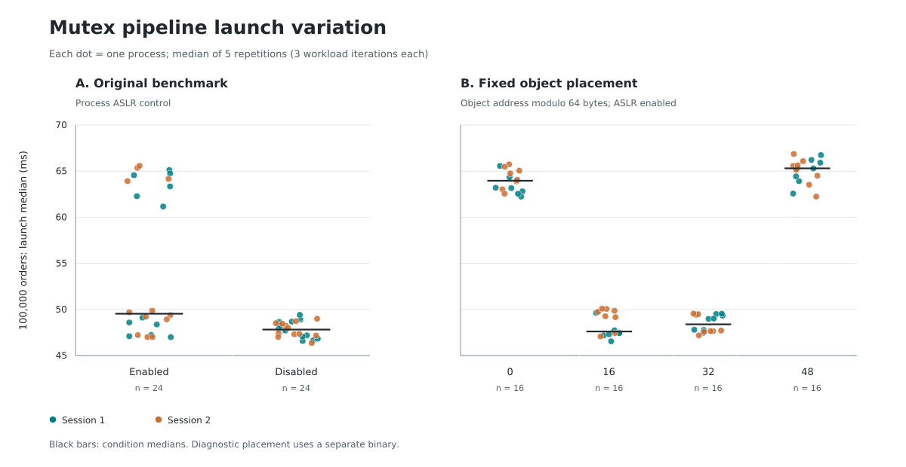

# What selects the mutex pipeline's launch-time performance level

The [repeated-launch study](../2026-10-12_15-11-09_e8870ee_control-repeatability/REPORT.md)
found that the mutex pipeline starts each launch at one of two levels, about
48 ms or about 66 ms for 100,000 orders, and keeps that level for the life of
the process. This study finds what selects the level.

An **offset** below is the engine object's address modulo 64: its byte position
inside a 64-byte cache line. A **launch score** is the median wall time of five
repetitions. **Spread** is `(largest / smallest - 1) × 100%`; **CV** is the
sample standard deviation of launch scores divided by their mean. A **block**
launches each condition of one recording once, in rotating order.

## How it was recorded

Six recordings, one per subdirectory, were made on 2026-10-14 from 13:32 to
13:43 with `scripts/bench_diagnose.py` at commit `65a2223`, two sessions each.
All ran in the `cleared` condition: every task of the user except one was
restricted to the cores that are not measured. The exception is
`systemd --user`, which the kernel does not let an unprivileged process move;
it is counted in every launch. A VirtualBox virtual machine had its state saved,
so its process had exited.

The unchanged benchmark binary is byte-identical to the one in the repeated-launch
study. The placement binary below is built from it by
`scripts/diagnostics/build_mutex_layout.py`, and rebuilding it at this commit
reproduces its recorded SHA-256.

A first recording of the same design, made with tools that were not yet
committed, in the `shared` condition while the virtual machine was running,
showed the same pattern. It is kept at the tag
`archive/launch-variance-first-recording`.

## Results: 100,000-order mutex pipeline

| Binary and condition | Launches | Median | Minimum–maximum | Spread | CV |
|---|---:|---:|---:|---:|---:|
| Unchanged, ASLR enabled | 24 | 49.53 ms | 46.99–65.58 ms | 39.55% | 14.65% |
| Unchanged, ASLR disabled for the process | 24 | 47.81 ms | 46.35–49.41 ms | 6.61% | 1.81% |
| Placement, offset 0 | 16 | 63.96 ms | 62.24–65.74 ms | 5.63% | 1.82% |
| Placement, offset 16 | 16 | 47.61 ms | 46.55–50.08 ms | 7.60% | 2.63% |
| Placement, offset 32 | 16 | 48.38 ms | 47.19–49.55 ms | 5.00% | 1.92% |
| Placement, offset 48 | 16 | 65.30 ms | 62.24–66.86 ms | 7.42% | 2.11% |

ASLR is address space layout randomisation. It stays enabled in the four
placement conditions; only the address modulo 64 is fixed. Each placement
condition used 16 different object addresses at 14 different positions within
a 4 KiB page, and each launch kept one address across its three workload sizes
and five repetitions.

With ASLR enabled, the unchanged binary gave 14 fast and 10 slow launches. With
ASLR disabled, all 24 launches were fast. Offsets 0 and 48 were slow in all 32
launches, and offsets 16 and 32 were fast in all 32.



**The mutex pipeline's level is selected by the position of the engine object
within a cache line.** The object lives on the main thread's stack, where ASLR
places it at one of the four 16-byte-aligned offsets in each launch. Fixing the
offset removes the switch between levels; the remaining launch-to-launch CV is
1.8% to 2.6%.

Across the 216 launches of the mutex pipeline in this study, the three workload
sizes were at the same level in every launch. None of the 1,080 repetitions at
100,000 orders fell on the other side of the midpoint between the two levels.
At 10,000 and 50,000 orders, 18 of 2,160 repetitions did.

Disabling ASLR does not guarantee the fast level. The stack address then depends
on the length of the command line and the environment, and other lengths can
select the slow offset. Applying `alignas(64)` to the object would select offset
0, which is slow in this build.

## Independent checks

**Native addresses.** GDB read the engine's address at its constructor in 16
launches of the unchanged binary with ASLR enabled, then detached before the
timed loop. The 11 launches at offsets 0 and 48 were slow (61.62–67.21 ms); the
5 at offsets 16 and 32 were fast (46.17–50.03 ms). Every launch is listed under
"Layout by launch" in the tables below. The recorder's CPU accounting follows
GDB rather than the benchmark, so this recording's CPU telemetry is not used.

**Worker placement.** Offsets 0 and 16 were crossed with three placements of
the two worker threads, 12 launches each. A preloaded library sets the workers'
CPUs and is loaded in all six conditions.

| Worker placement | Offset 0 | Offset 16 |
|---|---:|---:|
| Scheduler chooses within CPUs 1 and 3 | 63.62 ms | 49.33 ms |
| Consumer on CPU 1, producer on CPU 3 | 64.27 ms | 47.91 ms |
| Consumer on CPU 3, producer on CPU 1 | 63.56 ms | 49.51 ms |

All 36 launches at offset 0 were slow (61.06–70.29 ms) and all 36 at offset 16
were fast (46.83–50.52 ms). Which core runs which worker, and whether they can
migrate, does not create the split.

## What changes at the cache-line boundary

The unchanged binary constructs the engine at `%rsp + 0x70` in the throughput
function (`objdump -d -C build/release/bench_baseline_mutex`, the `lea` before
the call to `MutexMatchingEngine::MutexMatchingEngine()`). The object is 216
bytes with alignment 8. In this build the deque's start position pointer is at
byte 16, its finish position pointer at byte 48, the mutex lock word at byte 80,
the condition variable at 120, the completion flag at 168 and the latency
recorder at 192. These are properties of this build, not C++ guarantees.

| Object offset | Start pointer's line | Finish pointer's line | Mutex lock's line |
|---:|---:|---:|---:|
| 0 | 0 | 0 | 1 |
| 16 | 0 | 1 | 1 |
| 32 | 0 | 1 | 1 |
| 48 | 1 | 1 | 2 |

Line numbers count from the cache line that holds the object's first byte. At
the fast offsets the finish pointer shares a line with the lock. At the slow
offsets the two queue pointers share a line and the lock sits on the next one.
Other fields move between lines too. Recreating the worker threads does not move
the object, which is why a launch keeps its level.

## Hardware counters

The `perf` recording ran offsets 0 and 16 with the consumer on CPU 1 and the
producer on CPU 3, eight launches each. The counters cover whole launches:
start-up, allocation, thread creation and 2.4 million orders over the three
sizes. Medians of launches:

| Event | Offset 0 | Offset 16 | Ratio |
|---|---:|---:|---:|
| Core cycles | 6.459 billion | 4.982 billion | 1.30 |
| Instructions | 7.393 billion | 6.728 billion | 1.10 |
| Loads served by a line forwarded from another core (`mem_load_l3_hit_retired.xsnp_fwd`) | 7.147 million | 3.421 million | 2.09 |
| L2 requests for ownership (`l2_rqsts.all_rfo`) | 20.092 million | 15.067 million | 1.33 |
| Page faults | 84,906.5 | 85,750.5 | 0.99 |

All events ran 100% of the time. The forwarded-load event counts both modified
and clean lines. Twice as many forwarded loads and a third more ownership
requests at offset 0 point to cache lines moving between the two cores. Moving
the whole object does not isolate one field, so the data do not show which
field, or which access pattern, costs the extra time.
`scripts/diagnostics/summarize_perf.py perf --output <directory>` prints the
full table, including branches, cache misses, switches and migrations.

## Other two-thread benchmarks

Eight launches per condition with the unchanged binaries, 100,000 elements or
orders:

| Benchmark | ASLR enabled | ASLR disabled |
|---|---:|---:|
| SPSC producer/consumer queue | 3.40–5.94 ms, CV 17.3% | 4.43–7.95 ms, CV 24.7% |
| Mutex producer/consumer queue | 25.61–43.66 ms, CV 17.3% | 24.53–28.58 ms, CV 5.7% |
| SPSC matching pipeline | 27.78–30.05 ms, CV 3.1% | 27.49–29.67 ms, CV 2.6% |

Disabling ASLR left the SPSC queue as variable as before. It narrowed the mutex
queue here, but widened it in the first recording, so eight launches do not
establish an effect. The queue benchmarks remain unexplained. Per-role
placement, allocator behaviour and other address relationships are candidates.

## A hang in the mutex benchmark

An attempt at commit `a83f8b5`, before these recordings, hung in a placement
launch at offset 48 during the 10,000-order workload and was killed after 1,601
seconds. Two threads remained, both waiting on futexes and holding no CPU time:
the main thread joining a worker, and the consumer. The producer sets
`producer_done_` and calls `notify_all()` without holding `queue_mtx_`
(`benchmarks/bench_baseline_mutex.cpp`, `producer_loop`). A consumer that has
just found the queue empty and the flag unset can miss that notification and
wait forever. A launch either completes normally or hangs, so completed scores
are unaffected. `bench_diagnose.py` now stops a launch after 300 seconds.
Correcting the race changes the benchmark and belongs in its own pull request.

## Validity and limits

- Commit `65a2223`: the sources, benchmarks, tests and CMake configuration are
  identical to `e8870ee`. Intel Core i5-1135G7, kernel `7.0.0-34-generic`, GCC
  `15.2.0-16ubuntu1`, Release `-O2 -DNDEBUG -std=c++20`, Google Benchmark 1.8.3.
- Measurement mode: cores 3 and 1 measured, 0 and 2 for housekeeping; performance
  governor, turbo off, performance percentages 100/100, SMT siblings offline,
  device interrupts moved. Global ASLR stayed at 2 and transparent huge pages
  at `madvise`.
- All 248 launches: 0 thermal throttle events, 0 device interrupts on the
  measurement cores, 0 s suspended, package 44–55 °C. Every launch has frequency
  samples, with maxima of 2400.0 MHz; lower readings occur when a core idles.
- Foreign CPU time, the time other tasks ran on the measurement cores, had a
  median of 0.2 to 1.0 ms per second per condition and a maximum of 12.4 ms per
  second. It is not meaningful for the launches under `perf` or GDB, because the
  recorder's process clock follows the wrapper.
- Physical page placement, transparent huge pages, allocator arenas and the
  remaining kernel activity were not controlled. The result covers this build,
  this machine and one boot.

## Reproduce

```bash
python3 scripts/diagnostics/build_mutex_layout.py
mkdir -p build/diagnostics
cc -std=c11 -O2 -Wall -Wextra -Werror -fPIC -shared \
  scripts/diagnostics/thread_affinity.c -o build/diagnostics/thread_affinity.so -ldl -pthread
```

Save the state of any running virtual machine first. Then, for each recording,
with `<name>` and `<blocks>` from the table below:

```bash
python3 scripts/bench_diagnose.py --matrix scripts/diagnostics/<matrix> \
  --output results/<name> --sessions 2 --blocks <blocks> --repetitions 5 \
  --interference cleared --allow-unmovable systemd
```

The recorder enters and leaves measurement mode through the two password-free
sudo commands. With ASLR disabled, keep the length of the command and the
environment fixed within a recording; the exact originals are in each raw
`*.command.json`.

| Subdirectory | Matrix | Blocks | Conditions × launches | Purpose |
|---|---|---:|---:|---|
| `aslr/` | `aslr_matrix.json` | 12 | 2 × 24 | Unchanged binary with and without ASLR |
| `layout/` | `layout_matrix.json` | 8 | 4 × 16 | Four fixed offsets, ASLR enabled |
| `affinity/` | `affinity_matrix.json` | 6 | 6 × 12 | Offsets 0 and 16 crossed with worker placement |
| `native-layout/` | `native_layout_matrix.json` | 8 | 1 × 16 | Addresses read by GDB from the unchanged binary |
| `perf/` | `perf_matrix.json` | 4 | 2 × 8 | Whole-launch hardware counters |
| `other-dual/` | `other_dual_matrix.json` | 4 | 4 × 8 | The queue benchmarks and the SPSC pipeline, with and without ASLR |

The figure is drawn by
`scripts/diagnostics/plot_launch_variance.py aslr layout`, run in this directory.

# Tables

Everything from here on is the unedited output of
`python3 ../../../../scripts/diagnostics/summarize.py aslr layout affinity native-layout other-dual perf`,
run in this directory.

Launch scores are medians of repetitions; times are in ms.
Spread = (max / min − 1) × 100; CV uses sample standard deviation; IQR uses inclusive quartiles divided by the median. CV requires at least two observations.
Layout counts use independent launches; repeated lines in a launch are deduplicated.

## aslr

### Benchmark

| condition | binary | benchmark | launches | repetitions | median_ms | min_ms | max_ms | spread_pct | launch_cv_pct | iqr_pct | within_cv_median_pct | within_cv_max_pct |
| --- | --- | --- | --- | --- | --- | --- | --- | --- | --- | --- | --- | --- |
| native_aslr | bench_baseline_mutex | BM_MutexPipeline_Throughput/10000/iterations:3 | 24 | 5 | 5.123 | 4.802 | 7.023 | 46.27 | 14.41 | 29.94 | 3.94 | 9.66 |
| native_aslr | bench_baseline_mutex | BM_MutexPipeline_Throughput/50000/iterations:3 | 24 | 5 | 24.932 | 23.415 | 33.454 | 42.87 | 15.06 | 32.44 | 2.86 | 5.51 |
| native_aslr | bench_baseline_mutex | BM_MutexPipeline_Throughput/100000/iterations:3 | 24 | 5 | 49.533 | 46.990 | 65.576 | 39.55 | 14.65 | 32.09 | 2.07 | 4.85 |
| native_noaslr | bench_baseline_mutex | BM_MutexPipeline_Throughput/10000/iterations:3 | 24 | 5 | 4.862 | 4.673 | 5.046 | 7.99 | 1.93 | 2.56 | 2.66 | 4.13 |
| native_noaslr | bench_baseline_mutex | BM_MutexPipeline_Throughput/50000/iterations:3 | 24 | 5 | 23.690 | 23.271 | 24.726 | 6.25 | 2.00 | 3.12 | 3.21 | 4.14 |
| native_noaslr | bench_baseline_mutex | BM_MutexPipeline_Throughput/100000/iterations:3 | 24 | 5 | 47.815 | 46.350 | 49.412 | 6.61 | 1.81 | 2.93 | 1.49 | 2.47 |

### Telemetry

| condition | binary | launches | throttle_core | throttle_package | device_irqs | thermal_irqs | suspended_s | foreign_ms_per_s_median | foreign_ms_per_s_max | foreign_above_5_ms_per_s |
| --- | --- | --- | --- | --- | --- | --- | --- | --- | --- | --- |
| native_aslr | bench_baseline_mutex | 24 | 0 | 0 | 0 | 0 | 0.00 | 0.53 | 2.37 | 0 |
| native_noaslr | bench_baseline_mutex | 24 | 0 | 0 | 0 | 0 | 0.00 | 0.58 | 9.37 | 1 |

## layout

### Benchmark

| condition | binary | benchmark | launches | repetitions | median_ms | min_ms | max_ms | spread_pct | launch_cv_pct | iqr_pct | within_cv_median_pct | within_cv_max_pct |
| --- | --- | --- | --- | --- | --- | --- | --- | --- | --- | --- | --- | --- |
| offset_00 | bench_mutex_layout | BM_MutexPipeline_Throughput/10000/iterations:3 | 16 | 5 | 6.438 | 6.121 | 6.623 | 8.20 | 2.34 | 3.03 | 4.82 | 8.65 |
| offset_00 | bench_mutex_layout | BM_MutexPipeline_Throughput/50000/iterations:3 | 16 | 5 | 32.160 | 30.655 | 32.969 | 7.55 | 2.24 | 1.78 | 2.62 | 5.48 |
| offset_00 | bench_mutex_layout | BM_MutexPipeline_Throughput/100000/iterations:3 | 16 | 5 | 63.958 | 62.236 | 65.738 | 5.63 | 1.82 | 2.91 | 1.88 | 3.29 |
| offset_16 | bench_mutex_layout | BM_MutexPipeline_Throughput/10000/iterations:3 | 16 | 5 | 4.806 | 4.472 | 5.100 | 14.05 | 4.37 | 6.95 | 3.69 | 7.32 |
| offset_16 | bench_mutex_layout | BM_MutexPipeline_Throughput/50000/iterations:3 | 16 | 5 | 23.695 | 23.142 | 25.144 | 8.65 | 3.00 | 5.23 | 2.90 | 5.12 |
| offset_16 | bench_mutex_layout | BM_MutexPipeline_Throughput/100000/iterations:3 | 16 | 5 | 47.608 | 46.545 | 50.082 | 7.60 | 2.63 | 4.75 | 1.61 | 3.66 |
| offset_32 | bench_mutex_layout | BM_MutexPipeline_Throughput/10000/iterations:3 | 16 | 5 | 4.789 | 4.476 | 4.943 | 10.43 | 2.76 | 3.19 | 4.34 | 6.41 |
| offset_32 | bench_mutex_layout | BM_MutexPipeline_Throughput/50000/iterations:3 | 16 | 5 | 24.224 | 23.473 | 25.009 | 6.54 | 2.23 | 3.96 | 3.10 | 5.22 |
| offset_32 | bench_mutex_layout | BM_MutexPipeline_Throughput/100000/iterations:3 | 16 | 5 | 48.383 | 47.186 | 49.547 | 5.00 | 1.92 | 3.67 | 1.81 | 3.78 |
| offset_48 | bench_mutex_layout | BM_MutexPipeline_Throughput/10000/iterations:3 | 16 | 5 | 6.581 | 6.060 | 6.904 | 13.93 | 4.50 | 7.80 | 5.55 | 8.14 |
| offset_48 | bench_mutex_layout | BM_MutexPipeline_Throughput/50000/iterations:3 | 16 | 5 | 32.835 | 31.582 | 33.691 | 6.68 | 1.91 | 2.36 | 2.72 | 5.48 |
| offset_48 | bench_mutex_layout | BM_MutexPipeline_Throughput/100000/iterations:3 | 16 | 5 | 65.301 | 62.240 | 66.862 | 7.42 | 2.11 | 2.53 | 2.33 | 4.15 |

### Telemetry

| condition | binary | launches | throttle_core | throttle_package | device_irqs | thermal_irqs | suspended_s | foreign_ms_per_s_median | foreign_ms_per_s_max | foreign_above_5_ms_per_s |
| --- | --- | --- | --- | --- | --- | --- | --- | --- | --- | --- |
| offset_00 | bench_mutex_layout | 16 | 0 | 0 | 0 | 0 | 0.00 | 0.45 | 1.25 | 0 |
| offset_16 | bench_mutex_layout | 16 | 0 | 0 | 0 | 0 | 0.00 | 0.44 | 9.34 | 1 |
| offset_32 | bench_mutex_layout | 16 | 0 | 0 | 0 | 0 | 0.00 | 0.57 | 9.61 | 1 |
| offset_48 | bench_mutex_layout | 16 | 0 | 0 | 0 | 0 | 0.00 | 0.43 | 0.54 | 0 |

### Layout

| condition | binary | layout_launches | unique_addresses | mod64_values | unique_mod64 | unique_mod4096 | multi_mod64_launches | multi_mod4096_launches |
| --- | --- | --- | --- | --- | --- | --- | --- | --- |
| offset_00 | bench_mutex_layout | 16 | 16 | 0 | 1 | 14 | 0 | 0 |
| offset_16 | bench_mutex_layout | 16 | 16 | 16 | 1 | 14 | 0 | 0 |
| offset_32 | bench_mutex_layout | 16 | 16 | 32 | 1 | 14 | 0 | 0 |
| offset_48 | bench_mutex_layout | 16 | 16 | 48 | 1 | 14 | 0 | 0 |

## affinity

### Benchmark

| condition | binary | benchmark | launches | repetitions | median_ms | min_ms | max_ms | spread_pct | launch_cv_pct | iqr_pct | within_cv_median_pct | within_cv_max_pct |
| --- | --- | --- | --- | --- | --- | --- | --- | --- | --- | --- | --- | --- |
| offset_00_threads_1_3 | bench_mutex_layout | BM_MutexPipeline_Throughput/10000/iterations:3 | 12 | 5 | 6.256 | 6.092 | 7.091 | 16.40 | 4.79 | 2.90 | 5.29 | 7.74 |
| offset_00_threads_1_3 | bench_mutex_layout | BM_MutexPipeline_Throughput/50000/iterations:3 | 12 | 5 | 32.208 | 31.503 | 34.694 | 10.13 | 2.67 | 2.99 | 2.16 | 4.58 |
| offset_00_threads_1_3 | bench_mutex_layout | BM_MutexPipeline_Throughput/100000/iterations:3 | 12 | 5 | 64.270 | 62.377 | 70.289 | 12.68 | 3.07 | 2.04 | 2.36 | 3.30 |
| offset_00_threads_3_1 | bench_mutex_layout | BM_MutexPipeline_Throughput/10000/iterations:3 | 12 | 5 | 6.255 | 5.788 | 6.684 | 15.49 | 4.83 | 7.85 | 5.40 | 9.99 |
| offset_00_threads_3_1 | bench_mutex_layout | BM_MutexPipeline_Throughput/50000/iterations:3 | 12 | 5 | 31.602 | 30.950 | 33.284 | 7.54 | 2.29 | 1.99 | 2.16 | 4.35 |
| offset_00_threads_3_1 | bench_mutex_layout | BM_MutexPipeline_Throughput/100000/iterations:3 | 12 | 5 | 63.561 | 62.433 | 66.108 | 5.89 | 1.84 | 2.50 | 2.57 | 3.76 |
| offset_00_threads_none | bench_mutex_layout | BM_MutexPipeline_Throughput/10000/iterations:3 | 12 | 5 | 6.356 | 6.077 | 6.750 | 11.08 | 3.40 | 4.28 | 5.35 | 8.21 |
| offset_00_threads_none | bench_mutex_layout | BM_MutexPipeline_Throughput/50000/iterations:3 | 12 | 5 | 32.036 | 30.283 | 33.383 | 10.24 | 2.80 | 2.49 | 3.61 | 4.26 |
| offset_00_threads_none | bench_mutex_layout | BM_MutexPipeline_Throughput/100000/iterations:3 | 12 | 5 | 63.617 | 61.057 | 64.981 | 6.43 | 1.91 | 2.92 | 2.25 | 3.77 |
| offset_16_threads_1_3 | bench_mutex_layout | BM_MutexPipeline_Throughput/10000/iterations:3 | 12 | 5 | 4.795 | 4.587 | 5.184 | 13.03 | 3.58 | 4.23 | 3.92 | 5.92 |
| offset_16_threads_1_3 | bench_mutex_layout | BM_MutexPipeline_Throughput/50000/iterations:3 | 12 | 5 | 23.718 | 23.248 | 24.817 | 6.75 | 2.62 | 5.43 | 2.45 | 3.78 |
| offset_16_threads_1_3 | bench_mutex_layout | BM_MutexPipeline_Throughput/100000/iterations:3 | 12 | 5 | 47.912 | 47.012 | 50.518 | 7.46 | 2.79 | 5.08 | 1.25 | 2.58 |
| offset_16_threads_3_1 | bench_mutex_layout | BM_MutexPipeline_Throughput/10000/iterations:3 | 12 | 5 | 4.870 | 4.570 | 5.206 | 13.90 | 4.78 | 9.02 | 2.99 | 4.67 |
| offset_16_threads_3_1 | bench_mutex_layout | BM_MutexPipeline_Throughput/50000/iterations:3 | 12 | 5 | 24.578 | 23.381 | 25.468 | 8.92 | 2.86 | 4.90 | 2.50 | 5.52 |
| offset_16_threads_3_1 | bench_mutex_layout | BM_MutexPipeline_Throughput/100000/iterations:3 | 12 | 5 | 49.513 | 47.403 | 50.456 | 6.44 | 2.59 | 4.39 | 1.39 | 2.82 |
| offset_16_threads_none | bench_mutex_layout | BM_MutexPipeline_Throughput/10000/iterations:3 | 12 | 5 | 4.906 | 4.644 | 5.085 | 9.50 | 2.89 | 4.14 | 3.51 | 5.42 |
| offset_16_threads_none | bench_mutex_layout | BM_MutexPipeline_Throughput/50000/iterations:3 | 12 | 5 | 24.607 | 23.300 | 25.036 | 7.45 | 2.40 | 3.53 | 2.54 | 3.48 |
| offset_16_threads_none | bench_mutex_layout | BM_MutexPipeline_Throughput/100000/iterations:3 | 12 | 5 | 49.327 | 46.833 | 50.376 | 7.57 | 2.46 | 3.92 | 1.41 | 2.26 |

### Telemetry

| condition | binary | launches | throttle_core | throttle_package | device_irqs | thermal_irqs | suspended_s | foreign_ms_per_s_median | foreign_ms_per_s_max | foreign_above_5_ms_per_s |
| --- | --- | --- | --- | --- | --- | --- | --- | --- | --- | --- |
| offset_00_threads_1_3 | bench_mutex_layout | 12 | 0 | 0 | 0 | 0 | 0.00 | 0.81 | 1.53 | 0 |
| offset_00_threads_3_1 | bench_mutex_layout | 12 | 0 | 0 | 0 | 0 | 0.00 | 0.95 | 7.54 | 2 |
| offset_00_threads_none | bench_mutex_layout | 12 | 0 | 0 | 0 | 0 | 0.00 | 0.66 | 1.38 | 0 |
| offset_16_threads_1_3 | bench_mutex_layout | 12 | 0 | 0 | 0 | 0 | 0.00 | 1.04 | 2.30 | 0 |
| offset_16_threads_3_1 | bench_mutex_layout | 12 | 0 | 0 | 0 | 0 | 0.00 | 0.95 | 8.11 | 1 |
| offset_16_threads_none | bench_mutex_layout | 12 | 0 | 0 | 0 | 0 | 0.00 | 0.83 | 11.89 | 1 |

### Layout

| condition | binary | layout_launches | unique_addresses | mod64_values | unique_mod64 | unique_mod4096 | multi_mod64_launches | multi_mod4096_launches |
| --- | --- | --- | --- | --- | --- | --- | --- | --- |
| offset_00_threads_1_3 | bench_mutex_layout | 12 | 12 | 0 | 1 | 12 | 0 | 0 |
| offset_00_threads_3_1 | bench_mutex_layout | 12 | 12 | 0 | 1 | 11 | 0 | 0 |
| offset_00_threads_none | bench_mutex_layout | 12 | 12 | 0 | 1 | 10 | 0 | 0 |
| offset_16_threads_1_3 | bench_mutex_layout | 12 | 12 | 16 | 1 | 11 | 0 | 0 |
| offset_16_threads_3_1 | bench_mutex_layout | 12 | 12 | 16 | 1 | 10 | 0 | 0 |
| offset_16_threads_none | bench_mutex_layout | 12 | 12 | 16 | 1 | 10 | 0 | 0 |

## native-layout

### Benchmark

| condition | binary | benchmark | launches | repetitions | median_ms | min_ms | max_ms | spread_pct | launch_cv_pct | iqr_pct | within_cv_median_pct | within_cv_max_pct |
| --- | --- | --- | --- | --- | --- | --- | --- | --- | --- | --- | --- | --- |
| native_layout_observation | bench_baseline_mutex | BM_MutexPipeline_Throughput/10000/iterations:3 | 16 | 5 | 6.544 | 4.798 | 6.919 | 44.19 | 13.50 | 24.35 | 13.83 | 28.30 |
| native_layout_observation | bench_baseline_mutex | BM_MutexPipeline_Throughput/50000/iterations:3 | 16 | 5 | 31.848 | 23.355 | 33.276 | 42.48 | 13.07 | 23.72 | 3.84 | 5.57 |
| native_layout_observation | bench_baseline_mutex | BM_MutexPipeline_Throughput/100000/iterations:3 | 16 | 5 | 63.632 | 46.173 | 67.206 | 45.55 | 13.28 | 23.43 | 2.32 | 3.50 |

### Telemetry

| condition | binary | launches | throttle_core | throttle_package | device_irqs | thermal_irqs | suspended_s | foreign_ms_per_s_median | foreign_ms_per_s_max | foreign_above_5_ms_per_s |
| --- | --- | --- | --- | --- | --- | --- | --- | --- | --- | --- |
| native_layout_observation | bench_baseline_mutex | 16 | 0 | 0 | 0 | 0 | 0.00 | 1461.11 | 1475.44 | 16 |

### Layout

| condition | binary | layout_launches | unique_addresses | mod64_values | unique_mod64 | unique_mod4096 | multi_mod64_launches | multi_mod4096_launches |
| --- | --- | --- | --- | --- | --- | --- | --- | --- |
| native_layout_observation | bench_baseline_mutex | 16 | 16 | 0;16;32;48 | 4 | 16 | 0 | 0 |

### Layout by launch

| condition | binary | session | block | mod64 | BM_MutexPipeline_Throughput/10000/iterations:3 (ms) | BM_MutexPipeline_Throughput/50000/iterations:3 (ms) | BM_MutexPipeline_Throughput/100000/iterations:3 (ms) |
| --- | --- | --- | --- | --- | --- | --- | --- |
| native_layout_observation | bench_baseline_mutex | 1 | 1 | 0 | 6.72 | 32.24 | 63.79 |
| native_layout_observation | bench_baseline_mutex | 1 | 4 | 0 | 6.46 | 30.74 | 61.62 |
| native_layout_observation | bench_baseline_mutex | 1 | 7 | 0 | 6.85 | 31.50 | 63.13 |
| native_layout_observation | bench_baseline_mutex | 1 | 8 | 0 | 6.92 | 32.07 | 63.47 |
| native_layout_observation | bench_baseline_mutex | 2 | 2 | 0 | 6.51 | 32.78 | 64.70 |
| native_layout_observation | bench_baseline_mutex | 2 | 6 | 0 | 6.58 | 32.41 | 65.02 |
| native_layout_observation | bench_baseline_mutex | 2 | 8 | 0 | 6.81 | 32.21 | 65.12 |
| native_layout_observation | bench_baseline_mutex | 1 | 3 | 16 | 4.82 | 23.36 | 46.17 |
| native_layout_observation | bench_baseline_mutex | 1 | 5 | 16 | 5.27 | 24.90 | 49.84 |
| native_layout_observation | bench_baseline_mutex | 1 | 6 | 16 | 5.08 | 24.92 | 50.03 |
| native_layout_observation | bench_baseline_mutex | 2 | 5 | 16 | 4.80 | 23.57 | 47.19 |
| native_layout_observation | bench_baseline_mutex | 2 | 7 | 32 | 5.00 | 24.57 | 48.55 |
| native_layout_observation | bench_baseline_mutex | 1 | 2 | 48 | 6.91 | 32.65 | 64.85 |
| native_layout_observation | bench_baseline_mutex | 2 | 1 | 48 | 6.83 | 33.28 | 66.68 |
| native_layout_observation | bench_baseline_mutex | 2 | 3 | 48 | 6.37 | 33.15 | 67.21 |
| native_layout_observation | bench_baseline_mutex | 2 | 4 | 48 | 6.57 | 31.63 | 64.40 |

## other-dual

### Benchmark

| condition | binary | benchmark | launches | repetitions | median_ms | min_ms | max_ms | spread_pct | launch_cv_pct | iqr_pct | within_cv_median_pct | within_cv_max_pct |
| --- | --- | --- | --- | --- | --- | --- | --- | --- | --- | --- | --- | --- |
| queues_aslr | bench_spsc_ring_buffer | BM_Mutex_ProducerConsumer/100000/real_time | 8 | 5 | 32.397 | 25.613 | 43.663 | 70.47 | 17.27 | 19.80 | 1.63 | 4.78 |
| queues_aslr | bench_spsc_ring_buffer | BM_SPSC_ProducerConsumer/100000/real_time | 8 | 5 | 5.084 | 3.399 | 5.941 | 74.78 | 17.30 | 21.76 | 3.45 | 42.56 |
| queues_noaslr | bench_spsc_ring_buffer | BM_Mutex_ProducerConsumer/100000/real_time | 8 | 5 | 25.996 | 24.534 | 28.583 | 16.50 | 5.68 | 8.17 | 1.00 | 2.01 |
| queues_noaslr | bench_spsc_ring_buffer | BM_SPSC_ProducerConsumer/100000/real_time | 8 | 5 | 5.300 | 4.430 | 7.954 | 79.53 | 24.72 | 51.12 | 3.62 | 15.73 |
| spsc_pipeline_aslr | bench_matching_engine | BM_Pipeline_Throughput/10000/iterations:3 | 8 | 5 | 2.472 | 2.331 | 2.658 | 14.00 | 4.34 | 6.14 | 17.51 | 30.93 |
| spsc_pipeline_aslr | bench_matching_engine | BM_Pipeline_Throughput/50000/iterations:3 | 8 | 5 | 13.334 | 12.972 | 13.939 | 7.46 | 2.47 | 3.21 | 2.02 | 3.21 |
| spsc_pipeline_aslr | bench_matching_engine | BM_Pipeline_Throughput/100000/iterations:3 | 8 | 5 | 29.126 | 27.778 | 30.046 | 8.16 | 3.07 | 4.57 | 1.89 | 4.13 |
| spsc_pipeline_noaslr | bench_matching_engine | BM_Pipeline_Throughput/10000/iterations:3 | 8 | 5 | 2.361 | 2.265 | 2.691 | 18.83 | 6.23 | 6.13 | 16.86 | 28.49 |
| spsc_pipeline_noaslr | bench_matching_engine | BM_Pipeline_Throughput/50000/iterations:3 | 8 | 5 | 13.293 | 12.620 | 13.667 | 8.29 | 2.54 | 2.28 | 2.61 | 4.03 |
| spsc_pipeline_noaslr | bench_matching_engine | BM_Pipeline_Throughput/100000/iterations:3 | 8 | 5 | 28.087 | 27.488 | 29.667 | 7.93 | 2.62 | 3.59 | 1.58 | 2.45 |

### Telemetry

| condition | binary | launches | throttle_core | throttle_package | device_irqs | thermal_irqs | suspended_s | foreign_ms_per_s_median | foreign_ms_per_s_max | foreign_above_5_ms_per_s |
| --- | --- | --- | --- | --- | --- | --- | --- | --- | --- | --- |
| queues_aslr | bench_spsc_ring_buffer | 8 | 0 | 0 | 0 | 0 | 0.00 | 0.82 | 1.79 | 0 |
| queues_noaslr | bench_spsc_ring_buffer | 8 | 0 | 0 | 0 | 0 | 0.00 | 0.67 | 0.78 | 0 |
| spsc_pipeline_aslr | bench_matching_engine | 8 | 0 | 0 | 0 | 0 | 0.00 | 0.24 | 12.41 | 1 |
| spsc_pipeline_noaslr | bench_matching_engine | 8 | 0 | 0 | 0 | 0 | 0.00 | 0.27 | 0.53 | 0 |

## perf

### Benchmark

| condition | binary | benchmark | launches | repetitions | median_ms | min_ms | max_ms | spread_pct | launch_cv_pct | iqr_pct | within_cv_median_pct | within_cv_max_pct |
| --- | --- | --- | --- | --- | --- | --- | --- | --- | --- | --- | --- | --- |
| profile_offset_00 | bench_mutex_layout | BM_MutexPipeline_Throughput/10000/iterations:3 | 8 | 5 | 6.175 | 5.771 | 6.463 | 11.99 | 3.82 | 5.17 | 5.11 | 8.55 |
| profile_offset_00 | bench_mutex_layout | BM_MutexPipeline_Throughput/50000/iterations:3 | 8 | 5 | 31.267 | 30.670 | 32.322 | 5.39 | 2.18 | 3.80 | 2.67 | 3.78 |
| profile_offset_00 | bench_mutex_layout | BM_MutexPipeline_Throughput/100000/iterations:3 | 8 | 5 | 63.055 | 60.585 | 65.199 | 7.62 | 2.40 | 2.65 | 2.44 | 2.91 |
| profile_offset_16 | bench_mutex_layout | BM_MutexPipeline_Throughput/10000/iterations:3 | 8 | 5 | 4.856 | 4.741 | 4.981 | 5.06 | 1.84 | 3.10 | 3.40 | 5.31 |
| profile_offset_16 | bench_mutex_layout | BM_MutexPipeline_Throughput/50000/iterations:3 | 8 | 5 | 24.923 | 24.330 | 25.844 | 6.23 | 1.88 | 1.18 | 1.31 | 2.91 |
| profile_offset_16 | bench_mutex_layout | BM_MutexPipeline_Throughput/100000/iterations:3 | 8 | 5 | 50.493 | 49.771 | 51.948 | 4.37 | 1.56 | 1.86 | 0.95 | 2.54 |

### Telemetry

| condition | binary | launches | throttle_core | throttle_package | device_irqs | thermal_irqs | suspended_s | foreign_ms_per_s_median | foreign_ms_per_s_max | foreign_above_5_ms_per_s |
| --- | --- | --- | --- | --- | --- | --- | --- | --- | --- | --- |
| profile_offset_00 | bench_mutex_layout | 8 | 0 | 0 | 0 | 0 | 0.00 | 0.92 | 1.26 | 0 |
| profile_offset_16 | bench_mutex_layout | 8 | 0 | 0 | 0 | 0 | 0.00 | 1.26 | 10.30 | 1 |

### Layout

| condition | binary | layout_launches | unique_addresses | mod64_values | unique_mod64 | unique_mod4096 | multi_mod64_launches | multi_mod4096_launches |
| --- | --- | --- | --- | --- | --- | --- | --- | --- |
| profile_offset_00 | bench_mutex_layout | 8 | 8 | 0 | 1 | 7 | 0 | 0 |
| profile_offset_16 | bench_mutex_layout | 8 | 8 | 16 | 1 | 8 | 0 | 0 |

